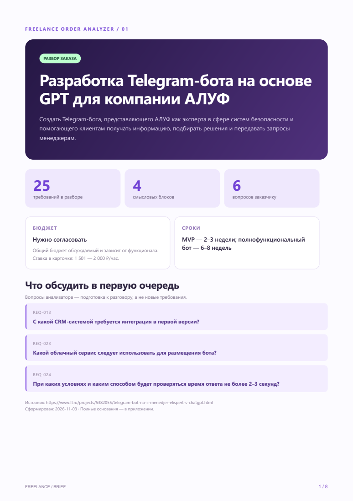

# ДЗ VPf10 — AI-автоматизация

Итоговая версия от 3 ноября 2026 года. Подготовлено Codex по обсуждению
с Евгенией; обновлено по её отзыву об оформлении PDF.

## Результат

Создан Python-проект, который превращает исходный текст в структурированные
данные и PDF. Сохранён обязательный сценарий урока — обработка диалога
с клиентом. Дополнительно реализован разбор объявления с фриланс-биржи
для подготовки к переговорам с заказчиком.

[Репозиторий](https://github.com/JaneEva08/freelance-order-analyzer)
· [PDF: CRM](docs/crm-report.pdf)
· [PDF: AI-бот](docs/ai-bot-report.pdf)
· [PDF: диалог](docs/dialog-example.pdf)

## Соответствие заданию

| Требование урока | Реализация |
|---|---|
| Принять текст диалога | main.py читает UTF-8 файл или стандартный ввод |
| Получить JSON от ИИ | utils/ai_processor.py вызывает модель и нормализует поля |
| Подставить данные в HTML | Jinja2 и templates/report_template.html |
| Создать PDF в reports/ | WeasyPrint, utils/pdf_generator.py |
| Обрабатывать ошибки и логировать этапы | Проверки входа, ответа, API и генерации; сообщения об ошибках |
| Дополнительный тип отчёта | analyze_order.py разбирает фриланс-заказы |

## Дополнительный сценарий: разбор заказа

Из объявления извлекаются цель, требования, обязательность, бюджет, сроки
и критерии приёмки. Отдельно формируются неясности и вопросы заказчику.
Требования имеют постоянные в рамках отчёта ID и дословные основания.
Неизвестные значения сохраняются как null, почасовая ставка не подменяет
общий бюджет проекта.

До создания PDF проверяются структура JSON, типы данных, статусы,
уникальность ID, ссылки вопросов и присутствие цитат в исходнике.
При ошибке ответа предусмотрено до двух попыток исправления.
Автоматического скачивания объявлений в приложении нет: вход — текстовый файл.

## Итоговое оформление PDF

- Первая страница: цель, количество требований и групп, бюджет, сроки,
  первые вопросы для обсуждения.
- Требования: карточки в две колонки, сгруппированные по смыслу.
- Статусы: отдельные цветные плашки для обязательного, предпочтений и опций.
- Приёмка и открытые вопросы: самостоятельный раздел.
- Основания: приложение с цитатами и исходными ID.
- Палитра: тёмный индиго, фиолетовый и мятный.

report_layout.py группирует данные для навигации и позволяет пересобирать
PDF из сохранённого JSON без нового API-запроса. Группировка основана
на ключевых словах; она не изменяет требования и не определяет их приоритет.



## Проверки и примеры

Реальные запросы выполнены через OpenAI-совместимого провайдера с моделью
gpt-6-luna из локальных настроек. Для этих прогонов заглушка не использовалась.

| Пример | Проверенный результат |
|---|---|
| Учебный диалог | Создан PDF на 1 страницу |
| Объявление о CRM | 58 требований, 9 вопросов; итоговый PDF с карточками — 11 страниц |
| Объявление об AI-боте | 25 требований, 6 вопросов; итоговый PDF с карточками — 8 страниц |

Все страницы новых PDF отрисованы и просмотрены. Кириллица отображается,
обрезки текста и наложения не обнаружены. При группировке проверена
сохранность всех ID на обоих примерах.

Четыре unittest проходят: принятие корректного ответа, отклонение
выдуманной цитаты, неизвестного ID в вопросе и повторяющегося ID.
В реальном прогоне недословная цитата была отклонена; исправленный ответ
прошёл проверку. Публичная копия проверена Gitleaks, секретов не найдено.

## Что показало сравнение

CRM содержит много ролей и связанных бизнес-процессов: важно сохранять
права доступа, модули и условность интеграций.
В заказе на AI-бота важны сроки, почасовая ставка, альтернативы каналов
уведомлений и способ проверки качества ответов.

Сверка Codex выявила три смысловые ошибки автоматического разбора:
обязательная AI-функция стала опциональной, альтернатива Telegram/email
превратилась в два обязательных канала, к критерию 95% не появился вопрос
о методике проверки. В опубликованных примерах эти места исправлены,
а исправления явно отмечены внутри PDF.

Таким образом, готовые примеры — результат генерации с последующей
сверкой Codex, а не безошибочный ответ модели или согласование с заказчиком.
Правила промпта дополнены; отдельный API-прогон именно после последнего
дополнения промпта не выполнялся. Новый дизайн собран из сохранённых JSON.

## Запуск

Установка Python-зависимостей, настройка .env и системные библиотеки
WeasyPrint для Windows описаны в [README.md](README.md).

```powershell
python main.py example_dialog.txt
python analyze_order.py examples/order.txt
python analyze_order.py order.txt --source-url https://example.com/order
python analyze_order.py order.txt --json-only
python report_layout.py reports/order.json --output reports/order-cards.pdf
python -m unittest discover -s tests -v
```

Ключи хранятся только в локальном .env. Поддерживаются OPENAI_API_KEY,
OPENAI_MODEL и OPENAI_BASE_URL для совместимого провайдера.

## Ограничения

Проверка JSON и точной цитаты не доказывает полноту извлечения и правильность
трактовки. Результат нужно сверять с исходником. Оценка стоимости разработки
и решение об отклике остаются за человеком.

WeasyPrint сообщил об использовании fontTools вместо HarfBuzz-Subset,
но PDF сформировались и открываются. Генерация изображений и Telegram-бот
в этой работе не проверялись: они не обязательны для ДЗ.

## Источники и сдача

- [ТЗ CRM на FL.ru](https://www.fl.ru/projects/5510622/sozdanie-crm.html)
- [ТЗ AI-бота на FL.ru](https://www.fl.ru/projects/5382055/telegram-bot-na-ii-menedjer-ekspert-s-chatgpt.html)

Существующий VPf10 переименован в freelance-order-analyzer с сохранением
истории и публичности. В репозитории опубликованы выбранный код, тесты,
вымышленный входной пример и проверенные PDF. Исходные полные тексты
объявлений отдельными файлами, платный конспект, ключи и личный архив
не опубликованы. Цитаты в PDF служат основаниями анализа.

Готовый текст ответа для платформы: [SUBMISSION.md](SUBMISSION.md).
Отправка на платформу курса не выполнялась.
